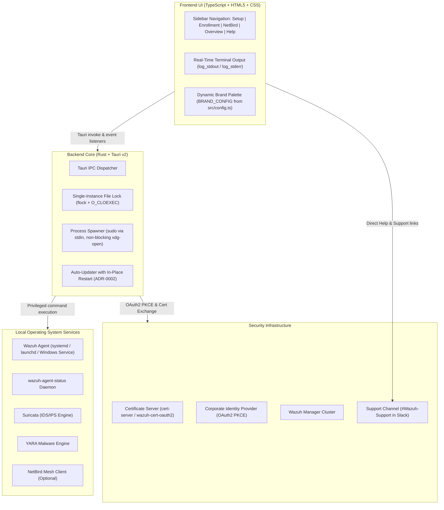
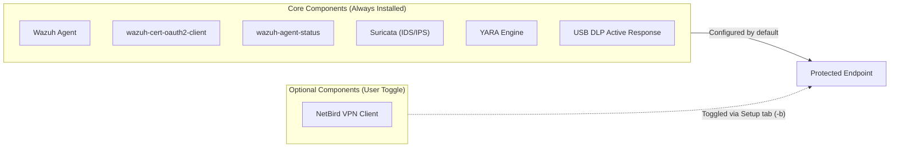
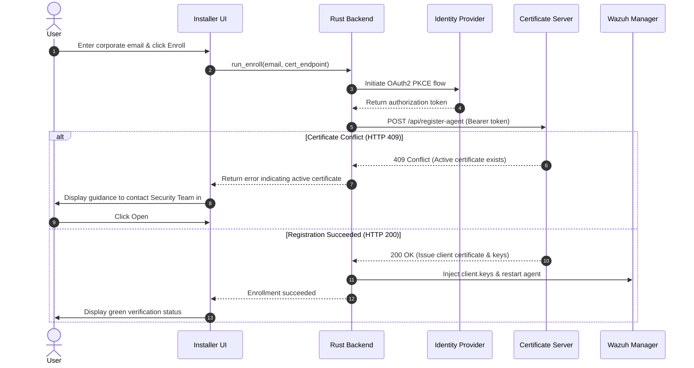

# Architecture Overview

This document describes the high-level architecture, design decisions, and security model of the Wazuh Agent Installer.

## System Topology

The Wazuh Agent Installer is a cross-platform desktop application built with [Tauri v2](https://v2.tauri.app/) and TypeScript. It coordinates the installation, configuration, and enrollment of a complete endpoint security stack across Linux, macOS, and Windows.

## Layered Architecture

### 1. Frontend Layer (`src/`)

- **Rendering Engine**: Native Webview managed by Tauri (WebKitGTK on Linux, WKWebView on macOS, WebView2 on Windows).
- **Application Logic**: Written in vanilla TypeScript using native DOM APIs without bulky frameworks (React, Vue, Angular), maintaining instantaneous launch times and minimal resource overhead.
- **Branding and Theme Configuration**: Centralized in `src/config.ts` (`BRAND_CONFIG`). The frontend injects color tokens into CSS custom properties (`--brand-primary`, `--brand-bg-root`, `--brand-text-primary`) during startup.
- **Real-Time Log Streaming**: Listens to backend log streaming events (`log_stdout`, `log_stderr`, `process_finished`) to display terminal output during installation, enrollment, and NetBird connection attempts.

### 2. Backend Bridge Layer (`src-tauri/src/`)

The Rust backend exposes strongly typed commands to the webview via Tauri's IPC mechanism:

| Command | Purpose | Code Reference |
| :--- | :--- | :--- |
| `run_install` | Executes `setup-agent.sh` or `setup-agent.ps1` with secure stdin password piping. | `src-tauri/src/lib.rs` |
| `run_enroll` | Performs certificate-based enrollment against the Certificate Server (`cert-server`). | `src-tauri/src/lib.rs` |
| `run_netbird_up` | Executes `netbird up` with management URL and setup key. | `src-tauri/src/lib.rs` |
| `check_components` | Probes system filesystem paths to verify installed binaries and versions. | `src-tauri/src/lib.rs` |
| `check_enrollment` | Verifies existence and validity of agent client keys (`client.keys`). | `src-tauri/src/lib.rs` |
| `check_netbird` | Reads NetBird daemon status via CLI JSON output. | `src-tauri/src/lib.rs` |
| `get_app_config` | Returns preconfigured manager, OAuth2, and NetBird URLs. | `src-tauri/src/lib.rs` |
| `open_external_url` | Safely validates and launches external links (`http`, `https`, `slack`). | `src-tauri/src/lib.rs` |
| `restart_application` | Performs in-place binary relaunch after application updates (ADR-0002). | `src-tauri/src/lib.rs` |

## Security and Privilege Model

Installing security monitoring tools and kernel-level network filters requires root or administrator privileges. The installer adheres to the following security guarantees:

### 1. Sudo Authentication via Standard Input
- The application prompts for administrator credentials upfront through a secure password input field.
- Passwords are **never written to disk**, environment variables, or temporary configuration files.
- Credentials are piped directly through standard input (`stdin`) to privileged processes (e.g., `sudo -S`).
- Process stdin streams are flushed and closed immediately after authentication.

### 2. Single-Instance Execution Lock
- To prevent race conditions or corrupted package installations, the installer enforces single-instance execution.
- On Unix platforms, the lock file (`/tmp/wazuh-agent-installer.lock`) is acquired via `flock`.
- The lock file descriptor is opened with `O_CLOEXEC` to guarantee that file handles are not inherited by child processes.

### 3. Safe External URL Dispatch
- External links opened from within the application (documentation links, Slack channels) are strictly validated by `is_safe_url`.
- Allowed protocols are restricted to `http://`, `https://`, and `slack://`.
- Dangerous URL schemes (`file://`, `javascript:`, shell command executions) are rejected.

### 4. Asynchronous Process Spawning
- External helper commands on Linux (such as `xdg-open`) are spawned asynchronously with disconnected standard input, output, and error streams (`Stdio::null()`).
- This prevents child processes from blocking the Tauri event loop or holding stdout/stderr pipes open, eliminating UI and log freezes.

## Component Stack Overview

The installer provisions and verifies the following endpoint security components:

### Core Components (Installed by Default)
1. **Wazuh Agent**: Core security monitoring agent responsible for system log analysis, file integrity monitoring (FIM), vulnerability detection, and active response execution.
2. **OAuth2 Client (`wazuh-cert-oauth2-client`)**: Authenticates the agent with the central cluster using OAuth2 PKCE and issues mutual TLS client certificates.
3. **Agent Status Monitor (`wazuh-agent-status`)**: Background daemon continuously verifying agent health and handling automated recovery.
4. **Suricata**: Network intrusion detection and prevention system (NIDS/NIPS) analyzing network packets in real time. Configured via `IDS_ENGINE=suricata` and `SURICATA_MODE=ids` (or `ips`).
5. **YARA**: High-performance pattern matching engine evaluating files against custom detection rules.
6. **USB DLP Active Response Scripts**: Custom Wazuh active-response integration detecting, blocking, and reporting unauthorized USB storage and HID devices.

### Optional Component (User-Controlled Toggle)
- **NetBird**: WireGuard-based overlay mesh VPN client providing secure point-to-point networking between distributed agents.
  - Toggled via the **Install NetBird** checkbox in the Setup tab (`install_netbird`).
  - When enabled, the installer passes `-b` on Linux/macOS and `-InstallNetBird` on Windows to `setup-agent`.
  - Once installed, users can configure and monitor their mesh connection via the dedicated **NetBird** tab in the sidebar navigation.

## Enrollment and Conflict Handling Flow

The enrollment process utilizes OAuth2 PKCE verification followed by certificate negotiation with the Certificate Server (`cert-server`).

Per **ADR-0003**, self-service certificate overwriting is disabled in the UI to prevent accidental invalidation of active fleet certificates without security team review. Users encountering active certificate conflicts are routed directly to `#Wazuh-Support` via the in-app Help & Support action.
