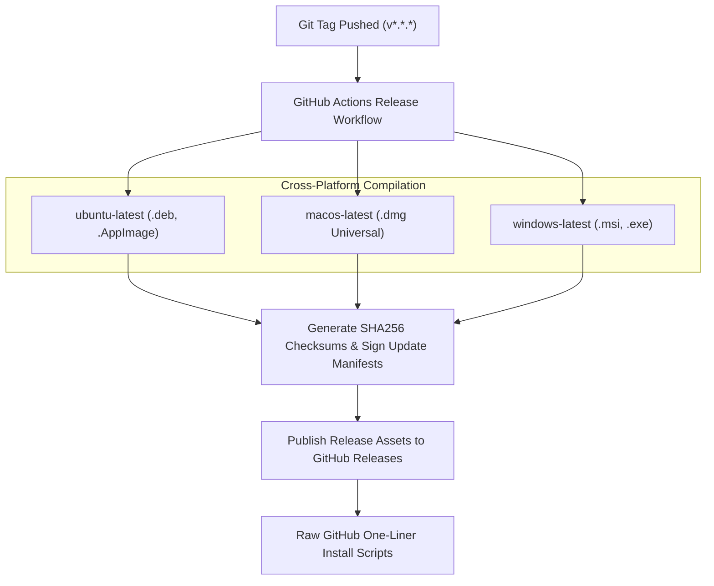
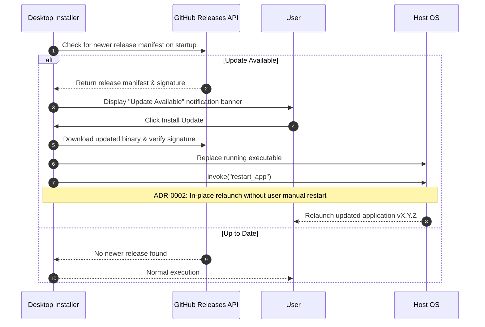

# Packaging and Distribution

This document details the build processes, packaging formats, and automated release workflows for the Wazuh Agent Installer.

## Distribution Formats

The application is distributed as native installation packages across supported operating systems:

| Platform | Format | Architectures | Target Location / Install Behavior |
| :--- | :--- | :--- | :--- |
| **Linux (Debian / Ubuntu)** | `.deb` | x86_64, aarch64 | Installs to `/usr/bin/wazuh-agent-installer`, registers desktop entry |
| **Linux (Universal)** | `.AppImage` | x86_64, aarch64 | Standalone executable, runs without system package installation |
| **macOS** | `.dmg` | Universal (Intel + Apple Silicon) | Drag-and-drop installer into `/Applications` |
| **Windows** | `.msi`, `.exe` | x86_64 | Standard Windows Installer package with uninstaller registration |

## Release Pipeline (`.github/workflows/release.yml`)

Releases are triggered automatically when a Git tag matching `v*.*.*` is pushed to GitHub.



1. **Matrix Builds**: Compiles native binaries across `ubuntu-latest`, `macos-latest`, and `windows-latest` using `tauri-action`.
2. **Artifact Signing**: Generates SHA256 checksums for each distributed package and signs updater manifests with the private Tauri updater key.
3. **GitHub Release Publishing**: Publishes all installers and checksum files directly to GitHub Releases.

## One-Liner Installation Scripts

For automated deployment or developer workstations, one-liner installation scripts are available in the `install-scripts/` directory:

### macOS Installation
```bash
curl -s https://raw.githubusercontent.com/ADORSYS-GIS/wazuh-agent-installer/develop/install-scripts/macos.sh | bash -s latest
```

### Linux (Ubuntu / Debian) Installation
```bash
curl -s https://raw.githubusercontent.com/ADORSYS-GIS/wazuh-agent-installer/develop/install-scripts/ubuntu.sh | bash -s latest
```

### Windows (PowerShell) Installation
```powershell
irm https://raw.githubusercontent.com/ADORSYS-GIS/wazuh-agent-installer/develop/install-scripts/windows.ps1 | iex
```

## Application Updates and Auto-Restart

The installer integrates with Tauri's native updater protocol:



- **Update Checks**: On startup, the application queries the GitHub Releases endpoint for a new release manifest.
- **Background Download**: If a newer version is available, the user is prompted to install the update.
- **In-Place Relaunch (ADR-0002)**: Once the update binary is applied, the application automatically restarts itself via `restart_app` so users immediately run the updated client without manual intervention.
