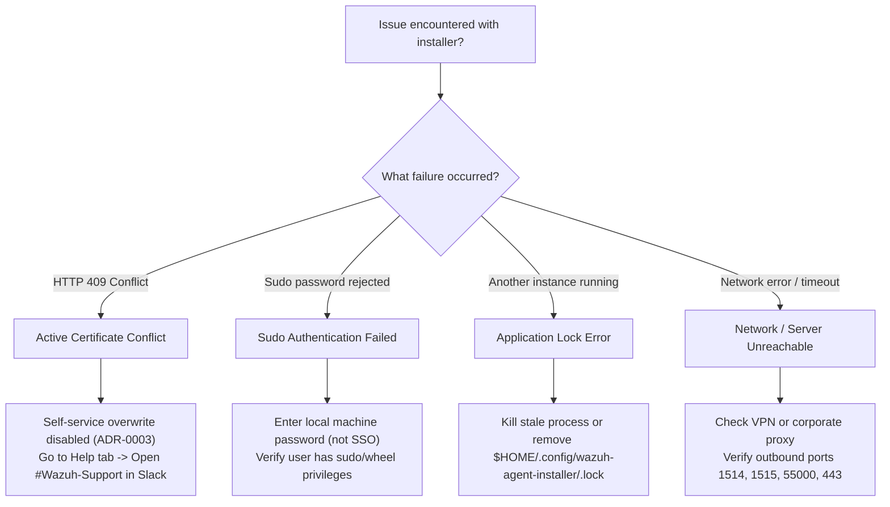

# Troubleshooting & Support Guide

This guide helps administrators and users resolve common issues encountered during installation, enrollment, or execution of the Wazuh Agent Installer.

## Troubleshooting Triage



## Common Issues & Resolutions

### 1. Active Certificate Conflict (HTTP 409)

#### Symptom
During enrollment, the application halts and displays:
> "Your account already has an active certificate. Please reach out to the Security Team for the next steps."

#### Cause
The user or email address already has an active, valid client certificate registered within the Wazuh cluster from a previous enrollment or a different machine.

#### Resolution
Per **ADR-0003**, self-service certificate overwriting is disabled to prevent accidental invalidation of active endpoint certificates across the fleet.
1. Open the application's **Help & Support** tab in the sidebar.
2. Click **Open #Wazuh-Support in Slack** to join the internal security support channel.
3. Request the Security Team to either re-issue existing keys or revoke the stale certificate so re-enrollment can proceed.

---

### 2. Privilege Elevation Denied or Failed

#### Symptom
The application exits at startup with `pkexec failed to launch` or fails to elevate administrator privileges.

#### Cause
- The administrator prompt was dismissed or cancelled by the user.
- The user account does not have administrative rights on the operating system (not in `sudo` or `wheel` group on Linux/macOS, or non-admin account on Windows).

#### Resolution
- Ensure you authenticate with your local administrator credentials when prompted by the operating system dialog.
- Verify your account has administrative rights:
  ```bash
  sudo whoami
  ```
- If prompted that the user is not in the sudoers file or lacks admin rights, contact your IT administrator to grant privileges.

---

### 3. Application Lock Error / Single Instance

#### Symptom
The application fails to start, reporting:
> "Another instance of Wazuh Agent Installer is already running."

#### Cause
A previous instance of the installer is still active in the background, or an unclosed process holds the file lock.

#### Resolution
- Check for existing running instances:
  ```bash
  # Linux
  pgrep -fl wazuh-agent-installer
  pkill -f wazuh-agent-installer

  # macOS
  killall "Wazuh Agent Installer"
  ```
- If no process is running, remove the stale lock file:
  ```bash
  rm -f "$HOME/.config/wazuh-agent-installer/.lock"
  ```

---

### 4. Network and Server Connectivity Failures

#### Symptom
Enrollment fails with `Network Error`, `Failed to connect to Certificate Server`, or connection timeouts.

#### Cause
- Firewall blocking outbound HTTPS traffic to the Certificate Server (`cert-server`) or Manager.
- Corporate VPN or proxy intercepting SSL/TLS traffic.

#### Resolution
- Verify DNS resolution and reachability of the Certificate Server:
  ```bash
  curl -vk https://<cert-server-endpoint>/health
  ```
- Verify communication ports with the Wazuh Manager:
  - `1514/TCP`: Wazuh agent communication
  - `1515/TCP`: Agent enrollment
  - `55000/TCP`: Wazuh API
- If connecting via VPN, ensure the VPN tunnel allows traffic to internal security infrastructure.

---

### 5. Inspecting Agent Logs

To inspect runtime logs from the underlying security services:

#### Linux
```bash
# Wazuh Agent service status
sudo systemctl status wazuh-agent

# Wazuh log file
sudo tail -f /var/ossec/logs/ossec.log

# Wazuh Agent Status daemon logs
sudo journalctl -u wazuh-agent-status -f
```

#### macOS
```bash
# Wazuh log file
sudo tail -f /Library/Ossec/logs/ossec.log

# Check agent status
sudo /Library/Ossec/bin/wazuh-control status
```

#### Windows
- Check Windows Event Viewer under `Applications and Services Logs` -> `Wazuh`.
- Inspect log file located at:
  `C:\Program Files (x86)\ossec-agent\ossec.log`

---

## Escalation and Support Channels

For issues requiring Security Team intervention:
- **Slack Support Channel**: Access `#Wazuh-Support` via the in-app **Help & Support** tab.
- **Help Tab**: The in-app **Help & Support** tab provides one-click links to Slack and self-service troubleshooting FAQs.
