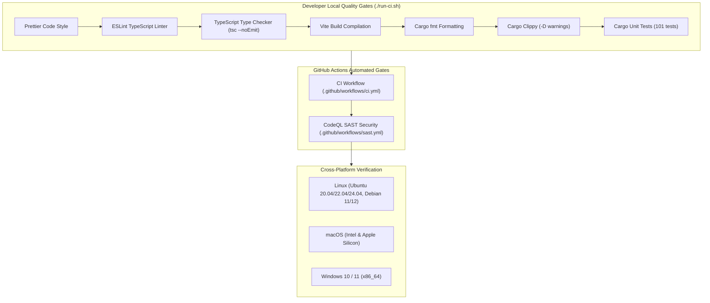

# Test Plan and Quality Assurance

This document outlines the testing strategy, test suites, static analysis, and validation criteria for the Wazuh Agent Installer.

## Testing Strategy Overview

The testing methodology ensures that security utilities, privilege escalation logic, process lifecycle management, and user interface workflows operate reliably across Linux, macOS, and Windows.



## 1. Rust Unit Test Suite

The Rust backend contains 101 comprehensive unit tests covering:
- **URL Safety Validation**: Tests for `is_safe_url` verifying allowed schemes (`http://`, `https://`, `slack://`) and rejecting unsafe schemes (`file://`, `javascript:`, command injection payloads).
- **Process Spawning**: Tests ensuring subprocess execution handles argument escaping, error propagation, and non-blocking execution safely.
- **Lockfile Handling**: Tests verifying single-instance locking behavior and `O_CLOEXEC` flag behavior.
- **Component Detection**: Tests for filesystem probing across diverse operating system directory layouts.

Run the test suite locally:
```bash
cd src-tauri
cargo test
```

## 2. Frontend Linting & Type Checking

Frontend testing relies on strict compiler guarantees and static analysis:
- **TypeScript Strict Mode**: Configured with `strict: true` and `noEmit` in `tsconfig.json` to prevent null/undefined pointer exceptions.
- **ESLint Rules**: Enforces clean coding standards, catches unused variables, and prevents DOM memory leaks.
- **Prettier**: Enforces consistent code formatting across TypeScript, HTML, and CSS.

Run frontend validations:
```bash
npm run build
npx prettier --check "src/**/*.{ts,html,css}"
npx eslint src/
```

## 3. Automated CI Pipeline (`.github/workflows/ci.yml`)

Every pull request and push to `develop` or `main` automatically runs GitHub Actions CI checks on Ubuntu runners:
- Node.js dependency installation and build verification.
- Rust toolchain caching and build check.
- `cargo fmt --check` enforcement.
- `cargo clippy -- -D warnings` linter gate.
- Full `cargo test` execution.

## 4. Security Scanning (`.github/workflows/sast.yml`)

Static Application Security Testing (SAST) runs automatically on all pull requests targeting `main` and `develop`:
- Scans Rust and TypeScript source code using CodeQL.
- Identifies common vulnerabilities including buffer overflows, command injections, unvalidated input, and credential leaks.
- Pull requests cannot be merged if security findings are identified.

## 5. Platform Validation Matrix

Before major releases, manual end-to-end verification is performed across standard OS targets:

| Platform | Target OS Versions | Architecture | Verification Focus |
| :--- | :--- | :--- | :--- |
| **Linux** | Ubuntu 20.04, 22.04, 24.04; Debian 11, 12 | x86_64, aarch64 | WebKitGTK rendering, systemd service detection, sudo stdin pipe, AppImage sandboxing |
| **macOS** | macOS 12 (Monterey), 13 (Ventura), 14 (Sonoma) | Intel (x86_64), Apple Silicon (M1/M2/M3) | Universal binary execution, launchd service management, Gatekeeper notarization |
| **Windows** | Windows 10, Windows 11 | x86_64 | Windows Service Controller, WebView2 availability, UAC elevation prompt |
